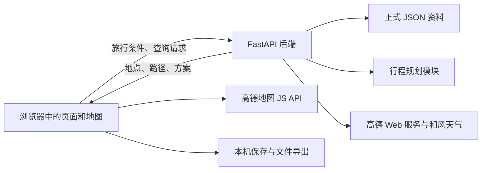

# 项目概览与技术栈

[返回首页](../README.md) · [代码结构](代码结构与阅读指南.md) · [数据来源](数据来源与制作说明.md) · [运行原理](运行原理与接口说明.md)

## 1. 项目做什么

“金陵行前”是面向南京旅游的 WebGIS 课程设计项目。用户在同一张地图上了解景点、交通、住宿与餐饮，填写出行条件后生成按天安排的旅行方案，并在地图与时间轴之间联动查看。

项目的主线是“旅行地图 + 行程规划”，地方特色是南京鸭类餐饮与鸭文化：既能查看鸭店的空间分布，也能在鸭子方案中结合旅行路线安排南京鸭用餐区域。

## 2. 一次完整使用流程

1. 浏览南京地图，搜索地点，查看收录景点的照片、开放时间、参考票价和预约渠道。
2. 选择住宿位置，或者在推荐住宿片区中查询酒店；确认首日出发点和末日结束点。
3. 通过十题问卷或完整表单填写日期、人数、预算、景点偏好和交通倾向。
4. 先生成一种方案，再按需生成其他类型：轻松方案使用建议游玩时长；紧凑方案使用最短合理时长；鸭子方案在旅行安排中优先匹配南京鸭正餐候选区域。
5. 切换日期，查看景点顺序、交通耗时、路线详情及预留的用餐时间，点击餐饮区域查看收录门店。
6. 保存方案，或导出可再次导入的 JSON 文件、便于展示的 PNG 行程单。

## 3. 主要功能与特色

| 功能 | 用户能看到的内容 | 实现要点 |
|---|---|---|
| 旅游地图 | 40 个景点、照片、专属图标、搜索结果与地点详情 | 高德底图叠加项目自己的点位和资料 |
| 住宿安排 | 六个推荐片区、酒店候选、地图选址及首末日起终点 | 片区资料预设，酒店信息按需查询 |
| 行程规划 | 1～5天三类方案、优先景点按日分散、每日时间轴和未安排原因 | 每日偏好加分递减，核对完整餐次与返程，再用实际交通调整 |
| 生成进度与排程调试 | 实际阶段、交通查询数量、逐轮评分与回放 | 默认后台完整记录，双击进度或反引号手动展开，收起后再生成不弹窗 |
| 地图联动 | 当前日路线、公交分段、步行与出租车详情 | 方案中的坐标和路径同时驱动地图、面板与时间轴 |
| 餐饮分析 | 普通餐饮分布、南京鸭分布和南京鸭门店 | 固定六边形网格、预先采集的餐饮快照与分类筛选 |
| 地方文化 | 8 篇鸭文化文章、可拖动的小鸭向导 | 带引用的内容资料与地图交互结合 |
| 使用教程 | 23 步可操作教程 | 在独立演示场景中复用实际页面和地图 |
| 保存与展示 | 本机保存、JSON 导入导出、PNG 行程单 | 保存完整方案快照，按快照恢复和导出 |
| 天气与界面 | 南京未来 10 天预报、主题切换 | 天气单独查询，界面使用统一样式变量 |

## 4. 技术栈及各自作用

| 技术 | 在本项目中的作用 | 对应位置 |
|---|---|---|
| Vue 3、JavaScript | 组织页面组件，管理表单、方案和地图选择状态；状态变化后同步更新界面 | [前端源码](../frontend/src/) |
| Vite 8 | 启动前端开发服务、转发开发环境的接口请求、生成发布用网页资源 | [前端配置](../frontend/vite.config.js) |
| CSS | 控制地图工作区、侧栏、弹窗、主题和不同窗口尺寸下的布局 | [样式目录](../frontend/src/styles/) |
| 高德地图 JS API | 提供底图、缩放与定位，并绘制点、线、多边形及自定义图层 | [地图模块](../frontend/src/map/) |
| Python、FastAPI | 提供 HTTP 接口，读取正式资料，校验输入并运行行程规划 | [后端入口](../backend/app/main.py) |
| Uvicorn | 运行 FastAPI 服务，接收浏览器请求 | [后端依赖](../backend/requirements.txt) |
| HTTPX | 后端异步访问高德、和风天气；共享连接和处理网络异常 | [高德传输层](../backend/app/amap_transport.py)、[天气服务](../backend/app/weather_service.py) |
| JSON Schema、jsonschema | 定义并校验旅行条件和方案结果的字段格式 | [请求与结果规范](../data/schemas/) |
| html-to-image | 将行程单页面转换为 PNG 图片 | [导出逻辑](../frontend/src/composables/useItineraryExport.js) |
| JSON、浏览器 localStorage | 分别存放正式静态资料和当前浏览器中保存的方案 | [正式数据](../data/formal/)、[本机保存逻辑](../frontend/src/planning/savedPlansStorage.js) |

具体依赖版本以 [package.json](../frontend/package.json)、[package-lock.json](../frontend/package-lock.json) 和 [requirements.txt](../backend/requirements.txt) 为准。推荐运行环境和安装命令见 [首页](../README.md)。

## 5. 各部分怎样连接

前端负责交互与绘图，后端负责规划、校验和外部服务查询。比如用户点击“生成方案”后，浏览器把旅行条件发给后端；后端结合景点资料与交通查询生成方案；浏览器再把同一份结果分别画成路线、每日列表和时间轴。

正式数据主要分两种：景点、地铁、餐饮快照和文化文章随项目提供；底图、地点搜索、酒店、交通和天气在使用对应功能时联网获取。服务查询的成功结果会按相应规则短期缓存。

## 6. 从哪里开始运行和阅读

先按 [首页的安装与配置步骤](../README.md) 启动前后端。课设版会先检查三项高德配置，检查通过后进入地图工作区。天气使用单独的可选配置。

希望理解代码时，按“页面入口 → 表单与请求 → 后端接口 → 规划模块 → 地图绘制”的顺序阅读，具体入口见 [代码结构与阅读指南](代码结构与阅读指南.md)。希望讲清课程设计中的数据工作时，先看 [数据来源与制作说明](数据来源与制作说明.md)。

景点资料、餐饮采样和地铁专题带有各自的整理或核验日期；规划使用这些资料给出旅行建议，实际出行时应结合景区公告与服务商最新信息。
